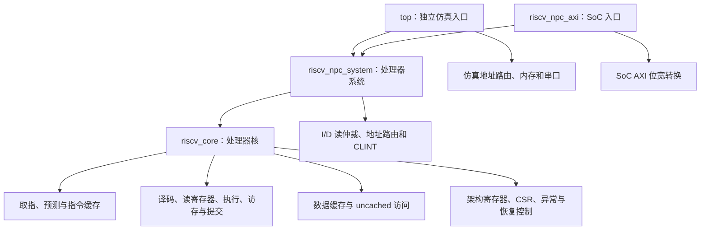

# RISC-V 设计模块总览与代码整理清单

检查日期：2026-09-05

范围：`npc/vsrc/riscv` 下全部 56 个 HDL 文件，包括 6 个 package、47 个非实验模块和
3 个实验模块，另检查两份 filelist。这里同时包含处理器 RTL、平台连接、仿真环境和实验。

2026-09-24 新增 `riscv_icache_replacement`，当前为 57 个 HDL 文件、48 个非实验模块；
其余分类不变。新增模块说明见[I-cache 替换逻辑](../microarchitecture/ICACHE_REPLACEMENT_DESIGN.md)。

本表覆盖当前文件与职责。此前逐文件检查及后续修复见 [实现记录](RTL_CLEANUP_RECORD.md)，
不代表已经逐项证明全部功能。
命名与格式修改的验证结果见 [验证记录](../verification/EXPERIMENT_LOG.md)。

## 1. 目录与命名

原目录 `vsrc/riscv32` 改为 `vsrc/riscv`，原设计模块和 package 的 `riscv32_` 前缀统一为
`riscv_`。构建使用 `PROJECT=riscv`；整数指令集仍由配置决定，当前为 RV64。

`riscv_config_pkg` 原来就没有绑定 32 位，名称保持。独立仿真的 `top`、DPI 函数以及外部
平台规定的端口名属于已有接口。真正描述 32 位数据的实验名称保留位宽说明，例如
`riscv_alu32_for_sta`。NEMU、软件目标与历史记录中的 RV32 名称不属于这次设计前缀迁移。

`filelist/filelist.f` 用于仿真，包含仿真统计开关与模块；`filelist/filelist_sta.f` 用于综合
分析。被列入 filelist 只说明源码参与构建，不等于模块已经在顶层实例化。

## 2. 本次已经统一的内容

- 设计目录、模块名、package 名、对应文件名、测试顶层及其构建引用。
- 综合约束文件名、平台 BlackBox 名称、DPI 层次访问和当前文档链接。
- 寄存器、预测记录、替换索引等数组名称，以及取指恢复请求的位集合名称。
- 已过期的 RV32、单周期、无前递和 P0～P6 阶段说明。
- 按工作区现有格式器进行列对齐和换行，检查代码标记仅有预定重命名变化。
- 修正格式器将续行过度右移的问题，并在本目录的 [AGENTS.md](../../vsrc/riscv/AGENTS.md)
  中列明修改时必须阅读的规范与模块记录。

下图按实例化关系归纳主要层次，箭头表示“包含”，不表示数据流向。共享 package 和
仿真统计模块未画出；每个文件的职责见下方表格。

## 3. 全部文件的职责与关注点

### common：配置、地址和共享类型

| 文件 | 当前职责 | 可读性、维护性与后续关注点 |
| --- | --- | --- |
| [riscv_config_pkg](../../vsrc/riscv/common/riscv_config_pkg.sv) | 全核位宽、容量和构建配置 | 只保留当前使用的配置；无实例使用的乱序候选容量已删除 |
| [riscv_addr_map_pkg](../../vsrc/riscv/common/riscv_addr_map_pkg.sv) | 物理地址区间、复位地址和地址范围判断 | 地址属于物理地址类型，避免与整数宽度混用 |
| [riscv_axi4_pkg](../../vsrc/riscv/common/riscv_axi4_pkg.sv) | core AXI 通道与方向结构体 | 保留 AXI 标准字段名，统一地址、数据和字节使能宽度 |
| [riscv_ysyx_soc_axi4_pkg](../../vsrc/riscv/common/riscv_ysyx_soc_axi4_pkg.sv) | 外部 ysyxSoC 的 AXI 类型 | 与 core AXI 类型分开，由转换模块连接 |
| [riscv_pkg](../../vsrc/riscv/common/riscv_pkg.sv) | ISA 编码、操作类型、流水级数据及事件定义 | 只保留当前接口类型；共用按字节合并函数，删除未使用的乱序占位类型 |

### core/frontend：预测、取指缓冲与指令缓存

| 文件 | 当前职责 | 可读性、维护性与后续关注点 |
| --- | --- | --- |
| [riscv_fetch_buffer](../../vsrc/riscv/core/frontend/riscv_fetch_buffer.sv) | 保存已返回指令并吸收译码反压 | 保持入队、出队、flush 与有效状态的关系清楚 |
| [riscv_fetch_control_flow_predictor](../../vsrc/riscv/core/frontend/riscv_fetch_control_flow_predictor.sv) | BHT、BTB、RAS 查询与训练 | 训练入口复用类型判断；查询、训练和返回栈的声明与计算分别组织 |
| [riscv_pma](../../vsrc/riscv/core/frontend/riscv_pma.sv) | 判断地址的执行、读写和缓存属性 | 复用地址表；区分 PMA 与未来虚拟内存权限 |
| [riscv_icache_replacement](../../vsrc/riscv/core/frontend/riscv_icache_replacement.sv) | 保存分段访问 RRIP 状态及候选路快照 | 同拍命中前递；反压保持；不重复保存 tag 或有效位 |
| [riscv_icache](../../vsrc/riscv/core/frontend/riscv_icache.sv) | 指令缓存查找、命中、替换和失效协调 | 已删除不能启用的回填字选择与逐字可见状态；保留原缺失请求提前返回 |
| [riscv_icache_tag_array](../../vsrc/riscv/core/frontend/riscv_icache_tag_array.sv) | 保存地址标记和行有效状态，提供同步读口 | 状态与数据的复位行为不同，注释应明确写入和失效条件 |
| [riscv_icache_data_array](../../vsrc/riscv/core/frontend/riscv_icache_data_array.sv) | 指令数据阵列与同步读出 | 当前使用暂存寄存器和低电平锁存写阵列，不能笼统称为普通触发器 RAM |
| [riscv_icache_miss_unit](../../vsrc/riscv/core/frontend/riscv_icache_miss_unit.sv) | 跟踪一次缺失、回填进度、原请求响应和错误 | 保留输出、下一值、时序更新顺序；注释已区分原请求提前返回和后续查找阻塞 |
| [riscv_icache_refill_axi4_master](../../vsrc/riscv/core/frontend/riscv_icache_refill_axi4_master.sv) | 将指令回填转换成 AXI 读突发 | 独立说明请求接收、AR/R 握手及每拍的有效传输大小 |

### core：指令流水线与架构状态

| 文件 | 当前职责 | 可读性、维护性与后续关注点 |
| --- | --- | --- |
| [riscv_core](../../vsrc/riscv/core/riscv_core.sv) | 连接取指、译码、执行、访存与提交 | 操作数选择与维护状态机已独立；接口声明与对应连接放近 |
| [riscv_operand_select](../../vsrc/riscv/core/riscv_operand_select.sv) | 选择读寄存器级与ID/EX的操作数 | 只选择数据，相关判断由冒险控制器负责 |
| [riscv_cache_maintenance_controller](../../vsrc/riscv/core/riscv_cache_maintenance_controller.sv) | FENCE.I的清理、重试与失效次序 | 清理失败时保持取指阻塞，撤下请求一拍后重试 |
| [riscv_ifu](../../vsrc/riscv/core/riscv_ifu.sv) | 发出预测与缓存请求，管理 tag、epoch 和返回指令 | 队列、预测关联数组、路径恢复分别组织；位集合与数组名称区分 |
| [riscv_idu](../../vsrc/riscv/core/riscv_idu.sv) | 提取指令字段并生成译码操作 | 大 case 本身不等于不合理；按指令类别保持默认值、合法性和输出定义一致 |
| [riscv_decode_stage](../../vsrc/riscv/core/riscv_decode_stage.sv) | 保存译码结果 | 简单 valid/ready 寄存级，无需强行改成枚举状态机 |
| [riscv_register_read_stage](../../vsrc/riscv/core/riscv_register_read_stage.sv) | 保存寄存器读值并处理同拍写读旁路 | 旁路说明与实际寄存器更新相邻 |
| [riscv_arch_regfile](../../vsrc/riscv/core/riscv_arch_regfile.sv) | 保存 x1～x31，读取 x0 时返回零 | 已改为 gpr_array_q，并修正 RV32 与无前递旧注释 |
| [riscv_csr_file](../../vsrc/riscv/core/riscv_csr_file.sv) | CSR 访问、合法性、异常入口和返回时状态更新 | 多类 CSR 更新集中在一个时序块；若拆分须保持异常、返回和普通写入的优先级 |
| [riscv_pmu](../../vsrc/riscv/core/riscv_pmu.sv) | 软件可见的周期、退休计数及控制位 | 与仿真统计分开；保留按计数器分组的更新 |
| [riscv_decode_execute_stage](../../vsrc/riscv/core/riscv_decode_execute_stage.sv) | 保存进入 EX 的指令和操作数 | 有效位与数据寄存器分开，检查旁路标记及反压语义 |
| [riscv_pipeline_hazard_controller](../../vsrc/riscv/core/riscv_pipeline_hazard_controller.sv) | 检测相关、选择前递、控制顺序核推进与清空 | 定向测试与深度20的形式检查已同步当前接口；M2按重命名、调度和ROB分解 |
| [riscv_exu](../../vsrc/riscv/core/riscv_exu.sv) | 整数、分支、CSR 运算及 LSU 请求生成 | 运算按功能块组织；是否拆成子模块随执行端口和时序决定 |
| [riscv_execute_result_stage](../../vsrc/riscv/core/riscv_execute_result_stage.sv) | 保存执行结果并检查预测是否正确 | 保留输出、有效位下一值、寄存器更新的顺序 |
| [riscv_lsu](../../vsrc/riscv/core/riscv_lsu.sv) | 访问大小、对齐、字节使能、读值扩展和完成响应 | 格式化函数与使用位置相近；已删除无调用的请求分类函数 |
| [riscv_completion_mux](../../vsrc/riscv/core/riscv_completion_mux.sv) | 在普通执行与 LSU 完成结果之间选择 | 保留简单组合结构，说明当前顺序核下的选择依据 |
| [riscv_writeback_stage](../../vsrc/riscv/core/riscv_writeback_stage.sv) | 保存即将提交的结果 | 明确 flush 取消下一次保存，不取消当前提交记录 |
| [riscv_commit](../../vsrc/riscv/core/riscv_commit.sv) | 形成提交记录并控制架构寄存器写入 | 描述当前行为；未来 ROB 不能提前写成已实现 |
| [riscv_trap_controller](../../vsrc/riscv/core/riscv_trap_controller.sv) | 根据提交记录生成异常或 mret 重定向 | 中断路径仍待接通，不能把存在 cause 字段当成已支持中断 |
| [riscv_frontend_redirect_register](../../vsrc/riscv/core/riscv_frontend_redirect_register.sv) | 选择恢复来源，并寄存各来源内容与选中索引 | 内部数组已加 _array；端口集合的后缀一致性留待独立接口整理 |

### core/memory：数据缓存与访存总线适配

| 文件 | 当前职责 | 可读性、维护性与后续关注点 |
| --- | --- | --- |
| [riscv_data_memory_subsystem](../../vsrc/riscv/core/memory/riscv_data_memory_subsystem.sv) | 按地址属性选择缓存或 uncached 路径 | 保持选择直到响应结束，避免用后续请求地址改写事务归属 |
| [riscv_dcache](../../vsrc/riscv/core/memory/riscv_dcache.sv) | 数据缓存查找、替换和脏行维护 | 已统一替换索引数组名称；按查找、旁路、维护、缺失接口整理声明 |
| [riscv_dcache_tag_array](../../vsrc/riscv/core/memory/riscv_dcache_tag_array.sv) | 保存标记、有效位和脏位 | 元数据写入与数据写入分工清楚，同周期读写规则需明确 |
| [riscv_dcache_data_array](../../vsrc/riscv/core/memory/riscv_dcache_data_array.sv) | 同步读取和按字节更新数据阵列 | 保持简单阵列职责，不引入替换或总线状态 |
| [riscv_dcache_miss_unit](../../vsrc/riscv/core/memory/riscv_dcache_miss_unit.sv) | 处理脏行写回、回填时合并 store 和返回原请求结果 | 写回与回填并行；写回失败后用唯一整行缓冲恢复旧脏行再报错 |
| [riscv_dcache_line_axi4_master](../../vsrc/riscv/core/memory/riscv_dcache_line_axi4_master.sv) | D-cache 行读写的 AXI 转换 | 读写状态独立，上游普通缺失已使用并行能力；空闲时首拍 AW/W 可直通 |
| [riscv_uncached_axi4_master](../../vsrc/riscv/core/memory/riscv_uncached_axi4_master.sv) | 将单次普通访存或 MMIO 转成 AXI 请求 | 地址、数据握手历史按实际事件命名，保持协议错误处理 |

### system：系统连接与平台边界

| 文件 | 当前职责 | 可读性、维护性与后续关注点 |
| --- | --- | --- |
| [riscv_npc_system](../../vsrc/riscv/system/riscv_npc_system.sv) | 合并 I/D AXI，连接 CLINT 并转发外部地址 | 主要为实例化和连接，可作为顶层组织的参考 |
| [riscv_axi4_core_merge](../../vsrc/riscv/system/riscv_axi4_core_merge.sv) | 仲裁指令和数据读事务，传递数据写通道 | 请求选择、事务锁和下一优先级分别有明确状态 |
| [riscv_axi4_address_router](../../vsrc/riscv/system/riscv_axi4_address_router.sv) | 按地址选择目标并保持事务归属 | select_vector 与 select_index 命名较清楚；后续统一循环索引和辅助函数名称 |
| [riscv_axi4_soc_width_converter](../../vsrc/riscv/system/riscv_axi4_soc_width_converter.sv) | core 与 ysyxSoC 数据宽度转换 | 读写状态分别组织；读请求与反向应答分开计算，保持各自组合依赖 |
| [riscv_npc_axi](../../vsrc/riscv/system/riscv_npc_axi.sv) | 将内部接口展开成 ysyxSoC 所需端口 | 平台端口名和 DPI 函数名是外部接口，不机械添加内部后缀 |
| [riscv_axi4_clint](../../vsrc/riscv/system/peripheral/riscv_axi4_clint.sv) | 计时及相关寄存器的 AXI 访问 | 区分计时、读事务、写事务；寄存器可访问不等于 core 已接受中断 |

### sim：仿真环境与统计

| 文件 | 当前职责 | 可读性、维护性与后续关注点 |
| --- | --- | --- |
| [riscv_sim_statistics_pkg](../../vsrc/riscv/sim/riscv_sim_statistics_pkg.sv) | 仿真监视器共用比例与延迟计算 | 不进入可综合filelist；不保存计数状态 |
| [top](../../vsrc/riscv/sim/top.sv) | 连接独立仿真环境并导出 DPI 调试接口 | 层次寄存器引用已同步；与SoC边界共用DPI导出；异常next PC改用同拍提交重定向 |
| [riscv_axi4_sim_mem](../../vsrc/riscv/sim/riscv_axi4_sim_mem.sv) | 仿真内存、突发访问和可控延迟 | 读写状态分开；作为行为模型保留仿真专用操作 |
| [riscv_axi4_uart_sim](../../vsrc/riscv/sim/riscv_axi4_uart_sim.sv) | 仿真串口访问与字符输出 | 按读写事务组织，打印操作与协议响应分开 |
| [riscv_sim_performance_monitor](../../vsrc/riscv/sim/riscv_sim_performance_monitor.sv) | 记录整核事件并报告性能估算 | 原始计数、控制流分类与候选估算分别组织；比例与延迟函数共用 |
| [riscv_sim_icache_performance_monitor](../../vsrc/riscv/sim/riscv_sim_icache_performance_monitor.sv) | 统计 I-cache 请求、命中、缺失和延迟 | 事件与计数器名称对应；报告输出与计时状态分组，共用比例和延迟函数 |
| [riscv_sim_dcache_performance_monitor](../../vsrc/riscv/sim/riscv_sim_dcache_performance_monitor.sv) | 统计 D-cache 访问、缺失、写回和等待 | 原始事件与推算值分别标记；比例与延迟计算使用共用仿真包 |

### experiments：独立教学与综合实验

| 文件 | 当前职责 | 可读性、维护性与后续关注点 |
| --- | --- | --- |
| [riscv_alu32_for_sta](../../vsrc/riscv/experiments/riscv_alu32_for_sta.sv) | 独立的 32 位 ALU 综合实验 | 名称保留真实数据宽度 32，避免误认作当前 RV64 EXU；不在正式 filelist 中 |
| [shl4_for_sta](../../vsrc/riscv/experiments/shl4_for_sta.sv) | 4 位可变移位综合实验 | 独立小实验，后续可把 in/out 改为说明含义的端口名 |
| [bcd7seg](../../vsrc/riscv/experiments/bcd7seg.v) | 七段数码管译码实验 | 不在正式 filelist 中；若重新使用，再按实验输入范围整理命名与端口后缀 |

## 4. 后续修改的依据

1. **保持功能与验证收敛**：已修复缓存反压、脏数据恢复和提交PC采样问题，并更新形式
   验证接口与性质。本轮清理、回归和面积/时序比较见 [实现记录](RTL_CLEANUP_RECORD.md)。
2. **保持局部结构清楚**：core 的操作数选择和维护控制已独立，预测器、缓存、宽度转换器
   与统计模块已按功能整理。后续新增逻辑继续把声明、计算与状态更新放在负责它的功能附近。
3. **独立处理接口变化**：数组端口后缀、模块拆分与公共类型拆分，
   每次形成小范围改动并运行受影响测试，不在机械重命名中顺便改变行为。
4. **最后根据需要优化结构**：状态数量、寄存器边界和旁路路径的改变会影响功能与时序，
   不能当成纯格式修改；需要对应的回归和时序依据。

代码行数只用于定位阅读成本，不作为必须拆分的阈值。大译码 case 可以保持集中；纯组合
选择器与简单流水寄存级不需要人为增加状态机。显式锁存阵列也不能按普通组合逻辑的规则
补默认赋值来消除其存储行为。

编码约定见 [命名与代码组织规范](../development/NAMING_GUIDE.md)，每次工作的验证范围见
[开发流程](../development/DEVELOPMENT_PROCESS.md)。

`riscv_redirect_arbiter` 与 `riscv_axi4_error_target` 因无实例和测试使用已删除；旧源码保留在
[修改前快照](../../result/verification/rtl-cleanup-20260905/before/vsrc/riscv)。共享DPI头文件
[riscv_sim_debug.svh](../../vsrc/riscv/sim/riscv_sim_debug.svh)不计入上述HDL模块与package数量。
