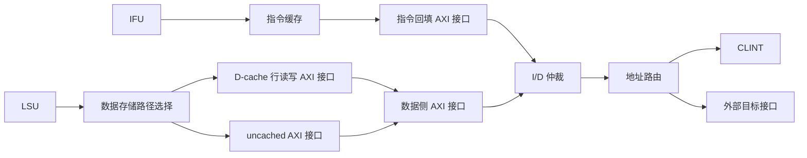

# AXI4 互连设计

状态：当前连接与事务范围说明

最后更新：2026-09-05

## 1. 当前连接

IFU 与 I-cache、LSU 与数据存储子系统使用本地请求/响应结构。AXI4 用于回填、写回、
uncached 访问以及系统互连。

数据存储子系统每次选择 D-cache 或 uncached 路径，合成一个数据侧 AXI 接口，再与指令侧
共享下游。外部 ysyxSoC 路径经独立模块转换到平台要求的 32 位数据接口。

## 2. 各模块负责什么

| 模块 | 职责 |
| --- | --- |
| `riscv_icache_refill_axi4_master` | 将指令回填请求转换为 AXI 读事务 |
| `riscv_dcache_line_axi4_master` | 将 D-cache 整行回填和写回转换为读写突发 |
| `riscv_uncached_axi4_master` | 将单次本地 load/store 转换为 AXI 访问 |
| `riscv_data_memory_subsystem` | 保存本次数据访问选择的路径，返回对应响应 |
| `riscv_axi4_core_merge` | 仲裁指令/数据读请求，写通道来自数据侧 |
| `riscv_axi4_address_router` | 按地址选择目标，保存事务归属 |
| `riscv_axi4_error_target` | 对未映射目标返回 DECERR 错误响应 |
| `riscv_axi4_soc_width_converter` | 转换 core 64 位与 ysyxSoC 32 位数据事务 |
| `riscv_npc_system` / `riscv_npc_axi` | 连接系统模块，并展开外部平台端口 |

拥有某个 AXI ID 字段不表示已经支持多个并发事务；是否支持必须由跟踪状态和回归证明。
CLINT 已有寄存器访问路径也不表示 CPU 中断输入已经接通，见 [流水线限制](../microarchitecture/PIPELINE_DESIGN_RECORD.md)。

## 3. 位宽、传输大小与并发

当前配置：core AXI 地址 32 位、数据 64 位；ysyxSoC 边界地址和数据均为 32 位。
一次 beat 携带多少有效字节由 `SIZE` 等事务字段决定，不能只看数据通道位宽。

| 访问路径 | 当前传输方式 |
| --- | --- |
| I-cache 可缓存回填 | 从行首开始的 INCR 突发，4 B 窄传输；默认 32 B 行为 8 个 beat |
| D-cache 行读写 | 默认每 beat 8 B；64 B 行为 8 个 beat |
| uncached load/store | core AXI 侧当前为单 beat，大小与字节使能按访问请求确定 |
| 64 位到 32 位平台转换 | 按传输大小拆分或转换，保持请求含义和响应归属 |

当前 I/D 仲裁最多保存一个未完成的读事务。AR 被阻塞时锁定选择与地址；AR 握手后保持
来源，直到接收最后一个读 beat。两侧同时请求时轮流获得下一次优先权。

读写通道分别处理。写地址 AW 与写数据 W 独立握手，B 表示写响应；不能用 AW 或最后一个
W 握手代替写事务响应完成。当前实现不支持跨 ID 乱序返回。

“采用完整 AXI4 接口”在这里表示使用 AXI4 通道和相关事务字段，不承诺支持协议允许的
所有突发类型、原子语义或并发组合。支持范围以实际 master、转换器和目标端的共同能力为准。

## 4. 必须保持的规则

- `valid` 已提出且未被接收时，保持通道内容稳定，直到握手或协议规定的复位。
- 请求来源和目标在事务期间保持一致，响应不能送给另一请求者。
- 错误响应也必须完成握手；一次本地请求只能得到一次对应完成响应。
- CPU flush 不会取消已经被下游接收的 AXI 请求，应完成传输后按指令身份处理结果。
- 宽度转换须正确处理地址、字节使能、响应错误和 burst 结束标记。
- burst 长度、传输大小、对齐及边界条件须按当前支持范围测试，不能由软件偶然不触发来代替定义。

## 5. 接下来与以后

M1 先验证现有仲裁、路由、反压、错误响应和宽度转换，并记录地址等待、数据等待与实际
传输字节数。协议带宽、有效带宽和 CPU 执行时间分别测量。

增加多 MSHR 或多未完成事务时，再设计 ID 分配、请求来源表、响应匹配和资源回收。
只扩宽总线或增加 ID 位数不会自动增加吞吐。

共享缓存、DMA 和加速器端口属于后续系统设计；接入时另外明确缓存一致性或软件维护规则。
它们不作为当前顺序核、第一版乱序核的前提。
