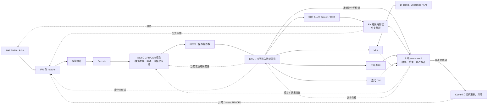

# 顺序发射流水线

更新：2026-09-26。本核是 RV64IM 单发射、顺序发射、允许功能单元乱序完成、顺序提交。
独立算术可以与乘除或已发出的访存重叠执行；等待操作数的指令仍会阻止后续指令发射。
当前没有独立重命名表、物理寄存器堆、动态选择就绪指令的队列或 LSQ。

## 指令经过哪些模块

Issue 是独立的功能模块，初版复用现有 ID/EX 寄存边界，没有为模块划分额外打拍。
普通 EX 结果保留寄存边界；scoreboard 的结果寄存器承担原 WB 的提交前时序边界，
活动路径不再经过旧 completion mux 和 WB 寄存器。是否继续拆分物理流水级由实际时序决定。

## 依赖、发射与完成

- `riscv_issue_ctrl` 检查已发射生产者和 ID/EX 中尚未发射的生产者。操作数可用才进入
  ID/EX；功能单元接收且 scoreboard 有空间时，指令才算发射。
- `riscv_scoreboard` 是在途指令与结果的唯一队列，同时承担依赖查询和有序提交职责，
  不建立重复保存相同数据的独立 ROB。
- 当前普通 ALU/分支结果、FU 当拍完成结果以及队列中已保存的结果都可前递。
  已完成但尚未提交的结果不必等待寄存器堆更新；异常结果不前递。
- 多条同名写分别保存在自己的结果槽中，查询只匹配最近的较老生产者。
  最新者未完成时必须等待，不能误取更老的已完成值；较老结果晚返回也不能重新参与前递。
  x0 不产生相关。满队列允许同拍提交与分配。
- MUL 可连续接收独立请求，DIV 一次处理一条；二者可以与其他功能单元重叠执行。
  各单元携带 scoreboard 索引返回，四个完成入口可以同拍接收不同指令的结果。
- ID/EX 不再替已发射的乘除保留整条指令。MUL 的标识随既有流水级推进，DIV 保存当前标识；
  没有新增运算级，也没有用多周期时序例外放宽运算反馈路径。

## 访存、串行化与提交

提交只检查最老条目。年轻 ALU 先完成时，其结果保留在自己的条目中，不能先更新架构寄存器。
队首发生异常时，提交异常并取消年轻指令，正常寄存器/CSR 副作用被屏蔽。

当前 LSU 可以越过无异常的 MUL/DIV，以及已经正常完成或当拍正常完成的较老普通执行项。
译码异常、当前完成异常、串行项和尚未完成的其他执行项仍阻止访存，store/MMIO 不越过未决异常。
前一条访存必须正常提交才释放唯一副作用上下文，提交当拍可以向下一条交接。
LSU 在途时可以执行年轻算术；仍不支持访存之间乱序或越过未发射指令。

CSR、mret、FENCE.I 沿用排空与串行化。FENCE.I 先清理 D-cache，再失效 I-cache，成功后恢复取指；
清理失败继续阻塞并重试。两级缓存仍是阻塞式，机器态定时器中断仍未接通。

scoreboard 每项只保留提交和依赖检查需要的元数据、结果、真实后继与异常。
LSU 的宽副作用载荷和 CSR 写值各保存一份：前者按单访存上下文授权，后者串行执行，
在提交前不会被另一条同类指令覆盖。功能单元完成入口已预留条目，因此不争用单一完成写口。

## 恢复范围

普通结果入口始终能够接收，分支在 EX 结果级解析的当拍会阻止下一条 ID/EX 发射。
因此分支纠错时，已经发射的工作都比该分支老，或就是该分支。此时只清未发射的年轻指令，
保留 scoreboard 和较老乘除。结果索引在旧项提交或整队列取消后复用。

提交异常/mret 则清空队列，并在同一时钟沿取消运算单元和普通结果级的有效状态。
访存只越过已排除异常的较老指令，因此同步异常时没有需要撤销的年轻 AXI 事务。
异步中断接入时须单独明确已授权副作用与中断接受的顺序。新请求只能在取消后的周期分配索引。
如果未来让年轻指令越过未解析分支，必须重新设计年龄、部分取消和迟到响应隔离。

非分支若携带错误的 taken 预测，仍提前恢复 PC+4。一位纠错历史防止保持中的指令重复恢复；
当前项尚未发射时保留它，发射时只取消同拍年轻输入。提交恢复优先于 FENCE.I、分支和非分支纠错。

## 验证与测量

详细契约见 [scoreboard](SCOREBOARD_DESIGN_RECORD.md)，运算电路见
[整数执行单元](EXECUTION_UNITS_DESIGN_RECORD.md)，本轮结果见
[等待优化验证](../verification/SCOREBOARD_WAITS_2026-09-26.md)，初版结果保留在[集成记录](../verification/SCOREBOARD_INTEGRATION_2026-09-26.md)。
仿真执行延迟按发射索引配对到完成；同拍多个返回分别计数。不同指令的执行时间会重叠，
不能把延迟之和当作 CPU 停顿周期。主 IPC 仍使用退休指令数除以活跃核周期。

旧 hazard controller、completion mux、WB 寄存器和对应单元测试保留供历史比较，
不再实例化在本轮活动后端；历史形式检查也不能替代新 scoreboard 的验证。
